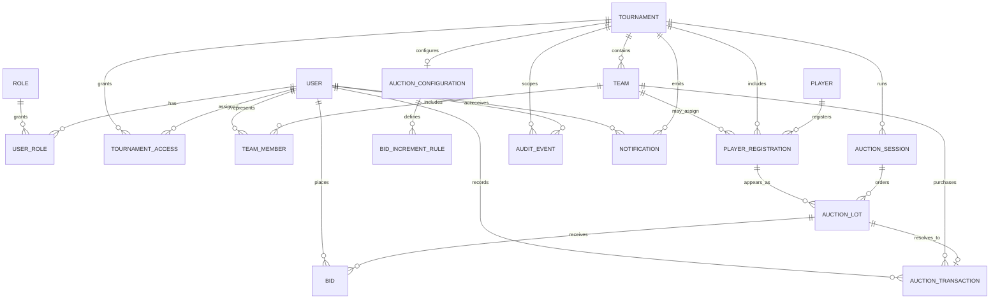

# JP AUCTION ARENA — Application Blueprint

## 1. Purpose and scope

JP AUCTION ARENA is a cross-platform cricket tournament and player-auction
management application for Web, Android, iOS, and Windows. It is designed as
one role-aware product with a shared Material 3 design system, common
navigation, and consistent tournament data across operator, team, and public
views.

This document defines the target product architecture and reserves space for
the requested future capabilities. Point 3 implements only local demo
authentication and client-side access guards. This document does not assert
that production authentication, cloud services, auction execution, payments,
or live synchronization are implemented.

## 2. Current baseline and evidence

The project manifest specifies Flutter/Dart, `flutter_riverpod`, `go_router`,
and `intl`; its declared targets and README describe a responsive Material 3
foundation. Existing tests describe intended earlier behavior for responsive
navigation, tournament CRUD/status/filtering, team validation/capacity, and
player CRUD/validation/filtering.

Before the Point 2 foundation, the tracked `lib/` tree contained only
`lib/main.dart` and had no app entrypoint. Foundation work added the app,
theme, shell, router, and shared widgets. Subsequent CI-failure remediation
added limited in-memory tournament/team/player models, repositories, and
screens. Point 3 adds local demo authentication and client-side role guards.
These current implementations do not include persistent storage, production
authentication, or backend-enforced authorization. See
[FEATURE_ROADMAP.md](./FEATURE_ROADMAP.md) for phase status and limitations.

## 3. Product principles and critical invariants

- One active tournament is permitted globally at any given time.
- Completed tournaments are retained as archives; archiving does not erase
  their teams, players, auction transactions, or reports.
- Only authorized Super Admins and assigned Tournament Admins / Auction
  Operators can configure or control bidding.
- Team Owners / Team Managers can see only their assigned team's operational
  information and cannot bid or control an auction.
- Public viewers have read-only access to explicitly published auction
  information.
- Purse balances, squad size, and category limits are enforced by trusted
  business logic, not only by client-side display rules.
- A player has one authoritative state per tournament: remaining/available,
  sold, unsold, or unavailable. A sale, assigned team, price, purse ledger, and
  transaction history must agree.
- Auction actions that affect state are attributable, ordered transactions.
  Realtime displays derive from the same authoritative state and recover from
  reconnects without inventing or dropping bids.
- Shared navigation, typography, spacing, components, and JP AUCTION ARENA dark
  navy / neon styling apply across every module. English is the application
  interface language.

## 4. Target architecture

### 4.1 Client architecture

Use feature-based clean architecture. Keep UI, domain rules, and persistence or
service details separated so later backends do not leak into widgets.

```text
Flutter application
├── app foundation
│   ├── Material 3 design system and responsive layout primitives
│   ├── GoRouter route tree, shell navigation, deep links, and access guards
│   ├── Riverpod dependency/state composition and error/loading conventions
│   └── platform adapters (Web, Android, iOS, Windows)
├── features
│   ├── identity_access, dashboard, tournament, team, player
│   ├── auction_setup, auction_live, team_portal, public_display
│   ├── results_reporting, history, administration, notifications
│   └── settings, support, import_export
└── shared
    ├── design components, formatting, validation, and responsive utilities
    └── domain-neutral infrastructure interfaces
```

Each feature follows the same dependency direction:

1. **Presentation:** screens/widgets; consumes feature providers/controllers;
   contains no persistence or auction-authority logic.
2. **Application:** use cases and Riverpod notifiers/providers; coordinates
   workflows and permission-aware commands.
3. **Domain:** typed entities/value objects, repository interfaces, invariants,
   and domain errors; independent of Flutter and service SDKs.
4. **Data:** repository implementations, DTO mapping, and local/remote data
   sources behind domain interfaces.

Cross-feature relationships use public domain interfaces or application
services. A feature must not import another feature's presentation layer.
Critical auction commands should have one authoritative application/service
boundary so multiple devices cannot independently accept conflicting sales.

### 4.2 Routing and responsive behavior

GoRouter owns the route hierarchy and navigation state. A shared authenticated
shell presents the same module destinations as a navigation rail/sidebar on
wide layouts and bottom navigation or a compact menu on narrow layouts. Detail,
form, and focused live-display routes can use full-screen layouts where
appropriate. Route guards check session state, role, tournament assignment,
and publication status; hidden controls are not a substitute for server-side
authorization.

Suggested route hierarchy (names are illustrative, not implemented routes):

```text
/splash
/intro
/login
/forgot-password
/app
  /dashboard
  /tournaments
    /new
    /:tournamentId
    /:tournamentId/edit
    /:tournamentId/teams
    /:tournamentId/players
    /:tournamentId/auction/setup
    /:tournamentId/auction/precheck
    /:tournamentId/auction/control
    /:tournamentId/auction/display
    /:tournamentId/team-view
    /:tournamentId/auction/players
    /:tournamentId/results
    /:tournamentId/reports
  /admin/*
  /notifications
  /settings
  /help
/live/:eventId                        (published, read-only view)
```

The route names above are a planning convention. Final URLs should be settled
when the routing implementation is approved.

### 4.3 Shared design system

Maintain a single Material 3 theme with the established dark navy / neon brand
identity, readable contrast, typography scale, spacing and breakpoint tokens,
and shared form, table/card, status, loading, empty, error, and confirmation
patterns. Support the same English labels and role-aware information
architecture across Web, Android, iOS, and Windows. Auction projector mode may
use a high-contrast presentation layout but remains part of the same brand
system.

## 5. Feature modules and dependencies

| Module | Responsibility | Depends on |
|---|---|---|
| App foundation | App startup, theme, shared shell, routing, responsive primitives, common errors | Shared design system; identity/access for guarded routes |
| Identity and access | Sign-in lifecycle, user profiles, roles, tournament/team assignments, permission policies | Demo repository and client-side policies; future trusted identity provider |
| Dashboard | Role-appropriate overview and shortcuts | Identity/access; tournament, auction, and notification summaries |
| Tournament management | Create/edit lifecycle, single-active constraint, details, archive/history | Identity/access; team, player, auction setup |
| Team management | Team registration, owners/managers, colors/logos, purse/squad configuration | Identity/access; tournament; player registration |
| Player management | Profiles, tournament registration, categories, statuses, import/export | Tournament; team (for assignment); import/export |
| Auction setup | Format, base prices, increments, rules, purse and squad constraints, readiness checks | Tournament; teams; registered players |
| Live auction | Ordered auction session, authorized controls, bids, sold/unsold/unavailable outcomes | Identity/access; auction setup; teams, players, transaction ledger |
| Team portal | Assigned team purse, roster, progress, and results; read-only | Identity/access; team; live auction/results |
| Public display | Published, read-only live display and projector presentation | Live auction public projection; no control dependency |
| Results and reporting | Final squads, transactions, statistics, exports, analytics | Tournament, teams, players, auction ledger |
| History and archives | Completed tournament discovery and read-only historical detail | Tournament, results/reporting |
| Administration | User/role management, subscriptions, audit, backup/restore | Identity/access; audit/event data; future payment/storage adapters |
| Notifications | Role-targeted in-app notices and later delivery channels | Identity/access; tournament and auction events |
| Import/export | CSV/Excel mapping, validation, preview, export, future CricHeroes compatibility | Player, team, tournament, results |
| Settings and support | App preferences, branding configuration, help and support | App foundation; administration for tenant branding |

Dependency direction is toward domain contracts and shared infrastructure;
live auction is not a dependency of the basic tournament/team/player
management screens. The live auction consumes prepared tournament, roster,
configuration, and purse data. Reporting and archives consume durable auction
and tournament records rather than becoming a second source of truth.

## 6. Complete screen inventory

The inventory preserves the 32 requested top-level destinations. Closely
related create/detail views are grouped into one module, not treated as
unrelated product features.

| # | Screen / screen group | Module | Primary access |
|---:|---|---|---|
| 1 | Splash Screen | App foundation | All |
| 2 | Onboarding / App Introduction | Identity and access | First-run users |
| 3 | Login | Identity and access | All account users |
| 4 | Forgot Password | Identity and access | Account users |
| 5 | Dashboard | Dashboard | Signed-in roles |
| 6 | Tournament Management | Tournament management | Super Admin; assigned Tournament Admin |
| 7 | Create / Edit Tournament | Tournament management | Super Admin; assigned Tournament Admin as authorized |
| 8 | Tournament Details | Tournament management | Authorized tournament users; public-safe summary where published |
| 9 | Team Management | Team management | Super Admin; assigned Tournament Admin |
| 10 | Team Registration and Team Details | Team management | Admin/operator; assigned team owner/manager for permitted profile fields |
| 11 | Player Management | Player management | Super Admin; assigned Tournament Admin |
| 12 | Player Registration and Player Details | Player management | Admin/operator; read-only team/public fields as permitted |
| 13 | Player Import / Export | Import/export | Super Admin; assigned Tournament Admin |
| 14 | Auction Configuration | Auction setup | Super Admin; assigned Tournament Admin/operator |
| 15 | Auction Rules and Bid Increments | Auction setup | Super Admin; assigned Tournament Admin/operator |
| 16 | Team Purse and Squad Configuration | Team management / auction setup | Super Admin; assigned Tournament Admin/operator |
| 17 | Auction Pre-check / Ready Screen | Auction setup | Authorized operator; read-only readiness for permitted viewers |
| 18 | Live Auction Control Room | Live auction | Super Admin; authorized Tournament Admin/operator |
| 19 | Live Auction Projector Display | Public display | Authorized setup; read-only display audience |
| 20 | Team Mobile View | Team portal | Assigned Team Owner / Team Manager |
| 21 | Public Live Auction View | Public display | Public Viewer |
| 22 | Sold / Unsold Player Management | Live auction / results | Authorized Tournament Admin/operator; read-only for permitted viewers |
| 23 | Auction Results | Results and reporting | Authorized tournament roles; published read-only view as permitted |
| 24 | Tournament Reports and Statistics | Results and reporting | Super Admin; assigned Tournament Admin; scoped read-only reports for team/public |
| 25 | Tournament History / Archives | History and archives | Super Admin; authorized tournament users; published read-only access |
| 26 | User and Role Management | Administration | Super Admin |
| 27 | Subscription and Payment Management | Administration | Super Admin / billing administrator when introduced |
| 28 | Notifications | Notifications | Signed-in users, scoped by assignment and role |
| 29 | Audit Logs | Administration | Super Admin; limited tournament audit access only if authorized |
| 30 | Backup and Restore | Administration | Super Admin |
| 31 | Application Settings | Settings and support | User preferences by role; global settings for Super Admin |
| 32 | Help and Support | Settings and support | All |

## User roles and permissions

The matrix describes the product authorization baseline; permissions must be
enforced at every trusted command/data boundary and scoped to the user's
tournament or team assignment. Current Point 3 guards enforce client
navigation only and are not a security boundary. Finer-grained grants may be
added without weakening these rules.

| Capability | Super Admin | Tournament Admin / Auction Operator | Team Owner / Team Manager | Public Viewer |
|---|---|---|---|---|
| Manage all tournaments, including activation/archive | Full | Assigned tournament only, if granted | No | No |
| Create/edit tournament teams and roster | Full | Assigned tournament | View assigned team; no tournament-wide edits | Published read-only data only |
| Register/edit players and import/export | Full | Assigned tournament | No; view only permitted roster data | Published read-only data only |
| Configure auction format, rules, increments, purses, and squad limits | Full | Assigned tournament | View assigned team's applicable limits | No |
| Start, pause, resume, control, or close bidding | Full | Assigned tournament when explicitly authorized as operator | No | No |
| Place bids | No client-side role; any administrative action must use audited operator controls | Authorized operator controls bidding on behalf of the auction; not a team bid | No | No |
| Mark player sold, unsold, or unavailable | Full | Assigned tournament | No | No |
| View purse, squad, and auction progress | All authorized scopes | Assigned tournament | Assigned team only | Published live/public data only |
| View final results and reports | All scopes | Assigned tournament | Assigned team/publicly published scope | Published results only |
| Manage users and global role assignments | Full | No, unless separately delegated by Super Admin | No | No |
| View audit logs | Global | Assigned tournament scope only if granted | No | No |
| Create/restore backups and manage subscriptions/payments | Full | No, unless separately delegated | No | No |
| Manage personal preferences and access help | Yes | Yes | Yes | Help/public information only |

Team Owners / Managers never submit or control bids. The operator-facing bid
command is an administrative action attributable to an authorized operator;
the application must not represent it as a team user's bid or allow a team
account to call the command. Public viewers have no write operations.

## 7. Data model overview

The following is a logical target model, not a committed schema or migration.
Identifiers, normalization, retention, and tenancy strategy require a later
implementation design.



### Entity responsibilities and relationships

- **User, Role, UserRole:** account identity and role grants. A role grant may
  be scoped to a tournament; Super Admin is a global authority.
- **TournamentAccess:** links a user to a tournament with an assigned
  administrative scope. Team access is derived from explicit team membership.
- **Tournament:** season/event metadata and lifecycle state (`draft`, `active`,
  `completed`, `archived`). Enforce the single-active invariant transactionally
  across all tournaments. Multiple completed/archived records are retained.
- **Team, TeamMember:** tournament-owned franchise/side and user ownership or
  management assignments. Purse and squad settings may be configuration
  records or validated team fields, but must be tournament-scoped.
- **Player:** reusable player profile and statistics. **PlayerRegistration**
  records that player's tournament-specific category, base price, eligibility,
  auction state, and current team assignment. This separates profile from
  season/auction state.
- **AuctionConfiguration, BidIncrementRule:** tournament format, base-price
  policy, increments, purse/squad/category constraints, and operating rules.
- **AuctionSession, AuctionLot, Bid:** ordered execution session, player lot
  state, and bid history. A bid is accepted only from an authorized operator
  action path; team users and public clients do not submit bids.
- **AuctionTransaction:** immutable sale/unsold/unavailable resolution record
  with actor, timestamp, player registration, team where applicable, final
  amount, and related accepted bid. A sold registration, its team assignment,
  purse balance/ledger, and transaction must be consistent.
- **AuditEvent:** append-oriented record of actor, action, scope, timestamp,
  and relevant before/after or event references. Do not rely on mutable display
  state as an audit trail.
- **Notification:** role- and assignment-scoped message generated from domain
  events.
- **Report/ExportJob, Subscription, PaymentRecord, BackupRecord:** reserved
  supporting entities for later reporting, billing, and recovery. Their
  external integrations are not part of this phase.

## 8. Backend and realtime plan (future, not integrated)

1. **Cloud identity and persistence:** Supabase Authentication and Supabase
   PostgreSQL as the primary cloud persistence layer. Establish tenant and
   tournament-scoped authorization before exposing data.
2. **Business logic:** use a Node.js backend API where authoritative
   transactions, complex validations, integrations, or privileged operations
   require a trusted server boundary. The client must not be trusted to enforce
   auction permissions, one-active-tournament, purse, or squad invariants.
3. **Local cache:** SQLite for mobile offline cache and queued non-conflicting
   work. Define explicit cache ownership, expiry, encryption, and conflict
   resolution before offline auction writes are enabled.
4. **Cloud live updates:** Supabase Realtime for authorized cloud
   synchronization. Use versioned events/transactions, idempotency, and
   reconnect snapshots; clients render server-authoritative state.
5. **Local network/offline mode:** a WebSocket transport for local LAN auction
   communication. Define a single elected/host authority, durable local
   transaction log, reconnect/replay behavior, and later cloud reconciliation
   before claiming equivalent correctness to the cloud mode.
6. **Interchange:** CSV and Excel import/export with schema validation,
   preview, duplicate handling, and safe error reporting. Reserve a mapping
   adapter for future CricHeroes data compatibility; no such integration is
   implemented or guaranteed by this blueprint.
7. **Billing and branding:** subscription/payment provider integration and
   white-label configuration are later additions, isolated behind service
   boundaries and feature entitlements.

## 9. Cross-cutting quality requirements

- Enforce authorization in routing, application use cases, and trusted
  backend/data policies; never depend on hiding buttons.
- Validate all state transitions and report actionable errors instead of
  silently accepting invalid state.
- Keep transaction and audit records suitable for results, dispute review, and
  recovery.
- Design responsive screens for keyboard, touch, projector, and constrained
  mobile layouts.
- Cover domain invariants and permission boundaries with unit, widget, and
  integration tests as each future phase is approved.
- Maintain accessible contrast, semantic labels, and consistent loading,
  empty, and error states.
