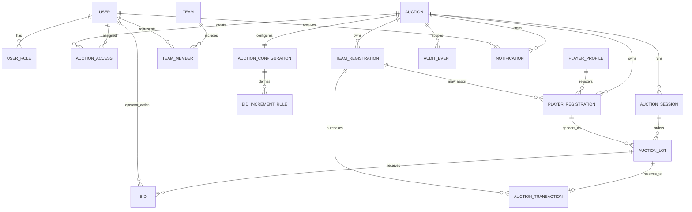

# JP AUCTION ARENA — Application Blueprint

## 1. Product purpose and direction

JP AUCTION ARENA is a professional cricket player auction management
application for Web, Android, iOS, and Windows. Its central product workflow is
to create independent cricket auctions, register auction-specific teams and
players, configure purse and auction rules, conduct authorized live bidding,
and retain results and transaction history.

This is **not a general tournament management system**. Auction is the primary
aggregate and owns its teams, players, purse settings, rules, bid history,
transactions, and results. Auction-specific records must never be mixed across
auctions. The previous tournament management source is retained for
compatibility, but its user-facing URL redirects to Auctions; do not extend it
as a general tournament product.

The application uses one role-aware navigation system and a shared Material 3
JP AUCTION ARENA dark navy, purple, electric-blue, and neon visual identity.
English is the interface language.

## 2. Current implementation and limits

- Flutter foundation, Riverpod state management, GoRouter, feature-oriented
  layers, responsive shell, shared design system, demo authentication, and
  four role definitions are implemented.
- Point 5 implements auction list/search/status filtering/date sorting,
  create/edit, details, settings, history/archive, lifecycle validation, and
  in-memory repository state.
- The dashboard is auction-first and shows repository-derived auction metrics;
  admins/operators have a prominent **CREATE NEW AUCTION** action.
- Point 6 adds auction-scoped team registration, search/status filters,
  create/edit/details, archive/restore, CSV validation/import, and CSV export
  through the clipboard. Auction details display registered team counts and
  link to team management. Team purse and squad limits are inherited from the
  auction configuration.
- Legacy tournament demo teams and player fixtures remain for compatibility;
  they are not treated as auction registrations. Player registration is not
  implemented yet.
- Data is in-memory and volatile. Demo seed data is synthetic. Authentication
  and route/role checks are client-side only.
- No live bidding, transaction ledger, Supabase, PostgreSQL, Node.js API,
  payments, cloud persistence, or realtime service is implemented.
- See [FEATURE_ROADMAP.md](./FEATURE_ROADMAP.md) for phase status and
  limitations.

## 3. Critical product invariants

- Auctions are independently addressable and own all future registrations and
  auction execution state. Each team, player registration, purse, rule, bid,
  transaction, result, notification, and audit event is scoped by auction ID.
- Only one auction may be Live globally at a time. Multiple Draft, Ready,
  Paused, Completed, and Archived auctions are allowed.
- Completed auction records and transaction history must be retained. Archiving
  is not deletion. Archived auctions are read-only unless an authorized admin
  restores them.
- Only authorized admins/operators may create, edit, activate, pause, complete,
  archive, and restore auctions. Operators are restricted to assigned auction
  IDs. Team Managers cannot create or control auctions; Public Viewers are
  read-only.
- Team purse and squad constraints must be enforced in trusted business logic.
  A sale, assigned team, player status, final price, purse ledger, bid record,
  and audit history must remain consistent.
- Live auction commands are authoritative, ordered, attributable transactions.
  Realtime displays derive from the same authoritative auction state and
  reconcile from server snapshots after reconnect.
- Live or completed auction configuration cannot be edited in a way that
  corrupts bidding or transaction records.
- Shared theme, navigation, typography, spacing, components, accessibility, and
  responsive behavior apply across all auction modules.

## 4. Architecture

### 4.1 Client architecture

Use feature-based Clean Architecture and repository contracts. Keep UI,
business rules, and persistence/service details separated:

1. **Presentation:** screens/widgets; consumes feature providers/controllers;
   contains no auction authorization or persistence logic.
2. **Application:** use cases and Riverpod providers; coordinates validation,
   access checks, repository calls, and feature workflows.
3. **Domain:** auction/team/player registration entities, repository
   interfaces, lifecycle and purse invariants, and domain errors; independent
   of Flutter and service SDKs.
4. **Data:** local or remote repository implementations, DTO mapping, and
   source adapters behind domain interfaces.

```text
Flutter app
├── core: configuration, errors, responsive helpers, routing, theme
├── shared: common widgets and design primitives
├── features
│   ├── auth and role access
│   ├── dashboard
│   ├── auction (auction aggregate and lifecycle)
│   ├── team (auction-scoped registrations; Point 6 local implementation)
│   ├── player (auction-scoped registrations; future)
│   ├── auction_setup and auction_live (future)
│   ├── team_portal and public_display (future)
│   ├── results_reporting and history
│   └── notifications, administration, settings, support, import_export
└── platform adapters: Web, Android, iOS, Windows
```

Features communicate through domain contracts or application services. A
feature must not import another feature's presentation layer. The live auction
must have one authoritative command boundary so separate devices cannot accept
conflicting sales.

### 4.2 Routing and responsive behavior

GoRouter owns the route hierarchy and navigation state. A shared authenticated
shell presents a sidebar/rail on wide screens and mobile navigation on narrow
screens. Detail, form, projector, and control-room routes may use focused
layouts while preserving the same theme.

```text
/splash
/login
/forgot-password
/app
  /dashboard
  /auctions
    /create
    /:auctionId
      /edit
      /settings
      /teams
        /create
        /:teamId
          /edit
  /teams                         (auction selector and team list)
  /players                       (auction-scoped feature, future)
  /auction/setup                 (future)
  /auction/live                  (future)
  /results                       (future)
  /reports                       (future)
  /history                       (completed/archived auction history)
  /team                          (assigned team view)
  /settings
/live/:auctionId                 (published, read-only view)
```

The legacy `/app/tournaments` route redirects to `/app/auctions`. Route guards
check authentication, permission, and operator auction assignment. Client-side
guards are not trusted server authorization.

### 4.3 Shared design system

Use the existing centralized Material 3 themes, dark navy and purple surfaces,
electric-blue accents, neon-pink highlights, white primary text, muted
secondary text, typography, spacing, radius, elevation, responsive breakpoints,
and shared form/card/dialog/loading/empty/error states. No feature-specific
theme is permitted. Projector mode may use presentation-friendly contrast while
remaining within the shared brand system.

## 5. Feature modules and dependencies

| Module | Responsibility | Depends on |
|---|---|---|
| App foundation | Startup, theme, shared shell, routing, responsive primitives, common errors | Shared design system and identity/access |
| Identity/access | Sessions, users, roles, auction/team assignments, permission policies | Auth repository; future trusted identity provider |
| Auction management | Create/edit, lifecycle, details, settings, history, independent auction identity | Identity/access; auction repository |
| Dashboard | Role-appropriate auction summaries and shortcuts | Identity/access; auction repository; scoped notifications |
| Team management | Register teams, owners/managers, logo reference, contacts, and status; purse/squad values inherit auction settings | Auction; identity/access |
| Player management | Profiles, auction registrations, category/base price/status, import/export | Auction; team where assignment applies |
| Auction setup | Formats, base prices, increments, rules, purse/squad/category constraints, readiness | Auction, registered teams and players |
| Live auction | Ordered session, authorized controls, bids, sold/unsold/unavailable outcomes | Auction setup; team/player registrations; transaction ledger |
| Team portal | Assigned-team purse, roster, progress, and results; read-only | Auction, team, live auction/results |
| Public display | Published, read-only auction display and projector | Live auction public projection |
| Results/reporting | Final squads, transactions, statistics, exports, analytics | Auction and durable transaction records |
| History/archive | Completed auction discovery and read-only historical detail | Auction lifecycle and results |
| Administration | User/role management, audit, backup/restore, subscriptions | Identity/access; audit/event data; future payment/storage adapters |
| Notifications | Role- and auction-scoped notices | Identity/access; auction events |
| Import/export | CSV/Excel mapping, validation, preview/export, future CricHeroes compatibility | Auction team/player registrations and results |
| Settings/support | User preferences, branding configuration, help/support | App foundation; administration for tenant branding |

## 6. Screen inventory

Related create/detail screens belong to their feature module and share the
common shell; they are not unrelated mini-apps.

| # | Screen / screen group | Module | Primary access |
|---:|---|---|---|
| 1 | Splash | App foundation | All |
| 2 | Onboarding / App Introduction | Identity/access | First-run users |
| 3 | Login | Identity/access | Account users |
| 4 | Forgot Password | Identity/access | Account users |
| 5 | Role-aware Dashboard | Dashboard | Signed-in roles |
| 6 | Auction List | Auction management | Super Admin; Auction Operator |
| 7 | Create / Edit Auction | Auction management | Super Admin; Auction Operator |
| 8 | Auction Details and lifecycle actions | Auction management | Super Admin; assigned Auction Operator |
| 9 | Auction Settings | Auction management/setup | Super Admin; assigned Auction Operator |
| 10 | Auction History / Archives | History | Super Admin; assigned Auction Operator |
| 11 | Auction Team Management | Team management | Super Admin; assigned Auction Operator |
| 12 | Team Registration and Team Details | Team management | Authorized admin/operator; assigned team view as permitted |
| 13 | Auction Player Management | Player management | Super Admin; assigned Auction Operator |
| 14 | Player Registration and Player Profiles | Player management | Authorized admin/operator; approved read-only fields |
| 15 | Player Import / Export | Import/export | Super Admin; assigned Auction Operator |
| 16 | Auction format, rules, and bid increments | Auction setup | Super Admin; assigned Auction Operator |
| 17 | Team Purse and Squad Configuration | Team/auction setup | Super Admin; assigned Auction Operator |
| 18 | Auction Pre-check / Ready Screen | Auction setup | Authorized operator |
| 19 | Live Auction Control Room | Live auction | Super Admin; authorized Auction Operator |
| 20 | Live Auction Projector Display | Public display | Read-only display audience |
| 21 | Team Mobile View | Team portal | Assigned Team Manager |
| 22 | Public Live Auction View | Public display | Public Viewer |
| 23 | Sold / Unsold Player Management | Live auction/results | Authorized operator; permitted read-only viewers |
| 24 | Auction Results and Statistics | Results/reporting | Admin/operator; published read-only access |
| 25 | Auction Reports and Analytics | Reporting | Super Admin; assigned Auction Operator |
| 26 | User and Role Management | Administration | Super Admin |
| 27 | Subscription and Payment Management | Administration | Billing admin when introduced |
| 28 | Notifications | Notifications | Signed-in users, scoped by auction and role |
| 29 | Audit Logs | Administration | Super Admin; scoped access if granted |
| 30 | Backup and Restore | Administration | Super Admin |
| 31 | Application Settings | Settings/support | User preferences; global settings for Super Admin |
| 32 | Help and Support | Settings/support | All |

Points 5-6 implement Auction List, Create/Edit Auction, Auction Details,
Auction Settings, Auction History/Archives, and auction-scoped Team
Management. Player registration, auction rules/increments, pre-check, live
bidding, display, results, reporting, administration, and external services
remain future work unless explicitly identified otherwise in the roadmap.

## 7. User roles and permissions

Permissions must be checked in routes, application services, and trusted
backend/data policies. The current demo application enforces role and
assignment checks on the client/service layer only.

| Capability | Super Admin | Tournament Admin / Auction Operator | Team Owner / Team Manager | Public Viewer |
|---|---|---|---|---|
| Create auctions | All | Yes | No | No |
| View/manage auctions | All | Assigned auction IDs | Approved assigned/public view only | Published public view only |
| Edit auction settings | All before Live | Assigned, before Live | No | No |
| Activate, pause, complete, archive/restore | All | Assigned auction | No | No |
| Manage auction teams and player registrations | All, when feature exists | Assigned auction | Assigned team view only | Published data only |
| Configure purse, squad, base prices, rules | All, when feature exists | Assigned auction | View only applicable team limits | No |
| Operate live bidding | All with audit | Assigned/authorized operator | No | No |
| Place/control bids | Admin action path only; auditable | Authorized operator on behalf of auction | No | No |
| View results and reports | All | Assigned auctions | Assigned team/public scope | Published results |
| Manage global users, billing, backup | Full | No unless separately delegated | No | No |
| View audit logs | Global | Assigned scope if granted | No | No |
| Preferences and help | Yes | Yes | Yes | Public help |

Team users never submit or control bids. Public viewers have no write operations.
An operator action is attributable to the operator, not represented as a team's
bid.

## 8. Data model and relationships

This is the logical target model, not a committed SQL schema. Auction identity
is the root isolation boundary.



- **Auction:** independent identity, date/time, type, cricket format, status,
  organizer, team/squad limits, base currency, and per-team purse.
- **AuctionAccess:** assigns an operator to one or more auction IDs.
- **TeamRegistration:** belongs to exactly one auction; contains team,
  manager, and auction-specific purse/squad configuration.
- **PlayerProfile / PlayerRegistration:** reusable player profile plus
  auction-specific category, base price, eligibility, state, and team.
- **AuctionConfiguration / BidIncrementRule:** rules and price increments
  belong to an auction and cannot be shared implicitly.
- **AuctionSession / AuctionLot / Bid:** ordered execution records scoped to a
  single auction. Operator bid actions retain actor/time/sequence.
- **AuctionTransaction:** immutable sold/unsold/unavailable resolution with
  auction, player registration, team, actor, time, final price, and bid
  references. Transaction, squad, purse ledger, and player state agree.
- **AuditEvent / Notification:** append-oriented, role/auction-scoped event
  history and messages.
- **Report/ExportJob, Subscription, PaymentRecord, BackupRecord:** reserved
  later supporting entities.

## 9. Future backend, persistence, and realtime plan

No integrations below are currently connected.

1. Supabase Authentication and PostgreSQL are intended cloud identity and
   primary persistence. Enforce tenant and auction ID row-level authorization.
2. Add a Node.js API only where trusted business logic, transaction
   serialization, integrations, or privileged commands need a server boundary.
   The client is not authoritative for single-live, purse, squad, or bid rules.
3. SQLite is the planned mobile cache. Define ownership, expiry, encryption,
   queued writes, and conflict resolution before offline auction writes.
4. Supabase Realtime is the planned cloud synchronization transport. Use
   versioned events, idempotency, and authoritative reconnect snapshots.
5. WebSocket is the planned local LAN/offline transport. Define one auction
   authority, durable local transaction log, replay, and cloud reconciliation.
6. CSV/Excel import/export needs schema validation, preview, duplicate handling,
   and safe errors. Future CricHeroes compatibility requires a tested mapping;
   it is not guaranteed or implemented.
7. Subscription/payment and white-label integrations are later additions behind
   service boundaries and entitlements.

## 10. Quality requirements

- Preserve strict auction-ID isolation in every repository and access policy.
- Enforce role permissions and lifecycle transitions at business and trusted
  backend boundaries, not only in widgets.
- Reject invalid purse/squad/date/currency/format input explicitly.
- Keep transaction and audit records suitable for results, dispute review,
  backup, and recovery.
- Design responsive keyboard, touch, projector, and constrained-mobile views.
- Test lifecycle, single-live, access, auction isolation, and loading/error
  states with domain, widget, and integration tests as phases are approved.
- Maintain accessible contrast and semantic labels across the shared design
  system.
