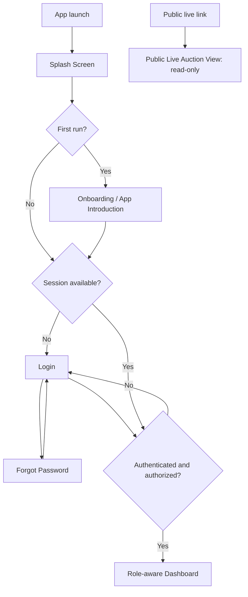
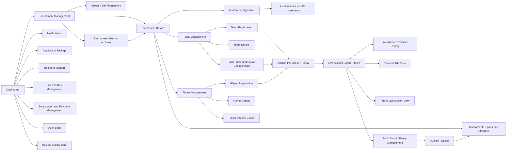
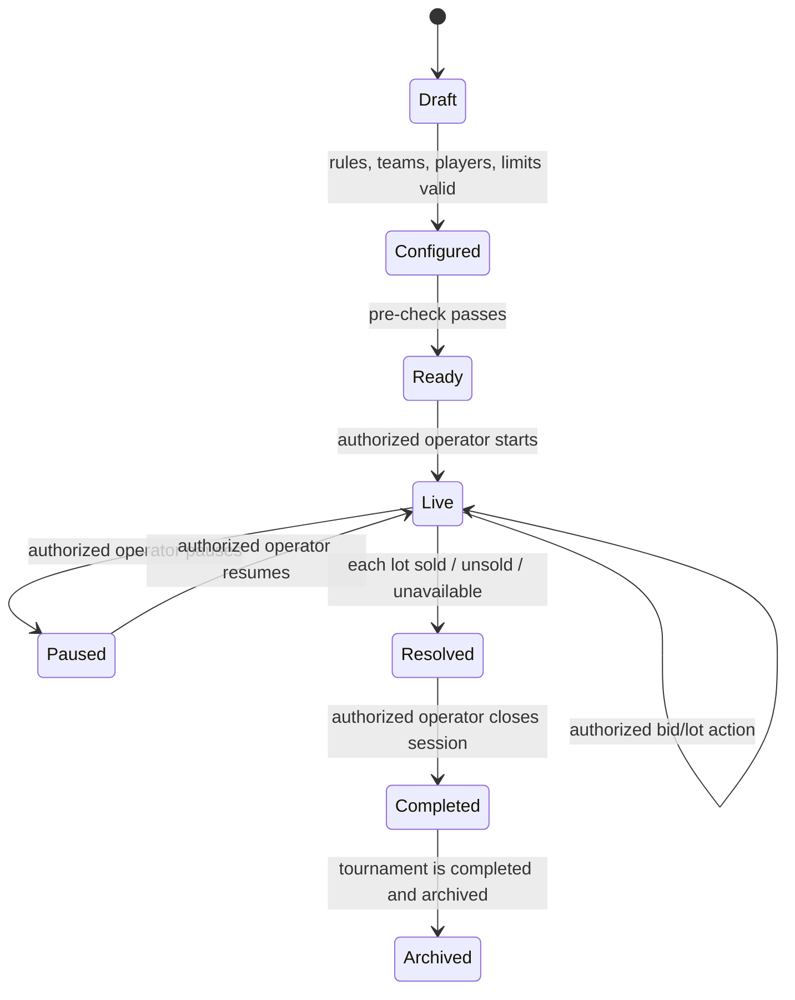

# JP AUCTION ARENA — Navigation Flow

This is the target navigation map for the approved product scope. Point 3
implements the login, session, role landing, and client-side route-guard
foundation; other destinations are conceptual until their feature phases.
The shared app shell and role-aware access rules apply to signed-in modules; a
navigation destination never grants permission by itself.

## 1. Entry and access flow



An authenticated user's role and tournament/team assignments determine the
dashboard shortcuts and accessible routes. A public live link is separate from
the admin shell, is read-only, and exposes only explicitly published fields.
The current Point 3 login uses in-memory demo accounts only; it is not
production authentication. Team managers are redirected to their team portal,
public viewers to the public live view, and administrative roles to the
dashboard.

## 2. Signed-in shell and feature navigation



The diagram presents relationships, not the permission to enter every
destination. For example, a Team Owner's Team Mobile View is restricted to the
assigned team and is read-only for auction activity. Projector and public views
cannot navigate into control functions.

## 3. Tournament lifecycle sequence

1. **Dashboard → Tournament Management.** View tournament list, status, and
   archive entry points.
2. **Create / Edit Tournament.** Enter event identity, season, dates, venue,
   and team capacity. Save as a draft.
3. **Tournament Details.** Review and manage the selected tournament. Activate
   only if no other tournament is active. Completed tournaments can be
   archived without deleting their history.
4. **Team Management → Team Registration → Team Details.** Register teams,
   owners/managers, and tournament-specific configuration.
5. **Player Management → Player Registration → Player Details.** Register
   player profiles for the tournament, categorize them, set base-price
   eligibility, and manage data import/export.
6. **Auction Configuration → Auction Rules and Bid Increments.** Select the
   auction format and define prices, increments, squad/category constraints,
   and auction rules.
7. **Team Purse and Squad Configuration.** Configure each team's purse and
   limits. Validate all team settings against the tournament configuration.
8. **Auction Pre-check / Ready Screen.** Show blocking issues and confirmations
   before opening a session (for example missing team setup, invalid limits, or
   unregistered players).
9. **Live Auction Control Room.** Authorized operator starts and controls the
   live session. It publishes state to read-only projector, assigned team, and
   public views.
10. **Sold / Unsold Player Management → Auction Results.** Resolve remaining
    players and review final squads and immutable transaction history.
11. **Tournament Reports and Statistics → Tournament History / Archives.**
    Produce and retain tournament summaries and exports.

## 4. Live auction navigation and state flow



For each player lot, the authoritative transition is:

```text
remaining/available -> sold(team, final price)
                    -> unsold
                    -> unavailable(reason, where required)
```

Only one terminal outcome may be committed for a lot. A sale updates the
player's tournament registration, team roster, purse ledger, transaction
history, and audit event atomically (or through a designed transactional
workflow with equivalent recovery guarantees). Public and team screens consume
the resulting state; they do not issue commands. Realtime delivery may be
delayed, so clients must reconcile against authoritative state after reconnect.

## 5. Role-aware navigation summary

| Role | Primary navigation | Restricted destinations/actions |
|---|---|---|
| Super Admin | All modules, all tournaments, administration | No product restriction beyond safeguards and auditability |
| Tournament Admin / Auction Operator | Assigned tournament dashboard, tournament/team/player setup, auction setup/control, results and reports | User/global role management, global subscriptions, backups, or other tournaments unless separately granted |
| Team Owner / Team Manager | Assigned team's mobile view, purse/squad, published progress/results, notifications, help/settings | No bidding, auction start/pause/resolve, other teams' private data, tournament configuration |
| Public Viewer | Published public live view, projector output, published results | No sign-in-only/private data, edits, commands, bids, or control room |

Detailed action permissions and invariants are in
[APP_BLUEPRINT.md](./APP_BLUEPRINT.md#user-roles-and-permissions).

## 6. Navigation and access behavior

- Preserve the selected tournament context while navigating among its teams,
  players, setup, auction, and reports.
- Keep list → detail → edit flows reversible with clear back navigation and
  unsaved-change confirmation.
- Scope shell destinations by role and assignment. Deep links must repeat
  authorization checks, including after a session change.
- Treat live control and live display as distinct route families/layouts; do
  not expose operator controls in team or public views.
- Open projector mode in a presentation-friendly route without changing
  authoritative auction state.
- Use a single shared responsive navigation shell for ordinary app modules.
  Adapt its presentation for Web/Windows wide layouts and mobile touch layouts.
- Provide clear loading, empty, permission-denied, offline, and recoverable
  connection states. Do not present stale data as live-confirmed.
- Keep public routes limited to published tournament and auction fields.

## 7. Route inventory cross-reference

The complete 32-screen inventory, grouped by product module and primary access
role, is maintained in [APP_BLUEPRINT.md](./APP_BLUEPRINT.md#complete-screen-inventory).
