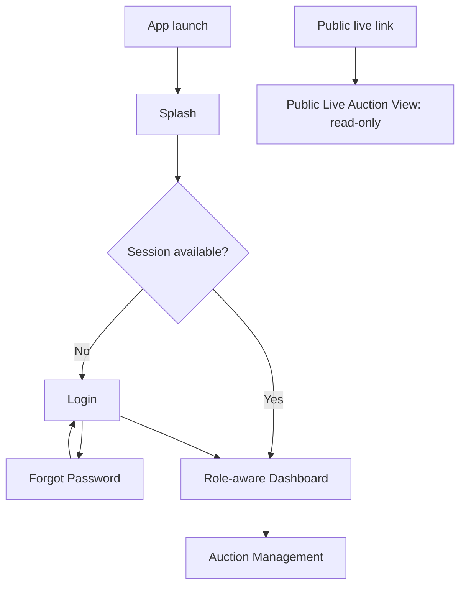
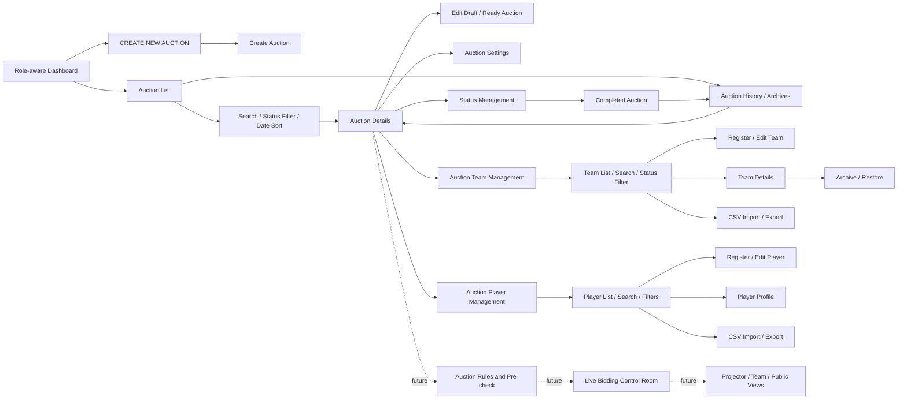

# JP AUCTION ARENA — Navigation Flow

The application is auction-first: an Auction is the primary workflow and owns
all future team/player registrations and auction transactions. The previous
tournament-management URL redirects to Auctions; do not extend it as a general
tournament product. Points 3-6 provide local demo authentication, role-aware
navigation, auction management, auction-scoped team registration, and auction-scoped player
registration.

## 1. Entry and access flow

Demo sign-in and sessions are local and non-production. Super Admins can access
all auctions. Tournament Admins / Auction Operators can create auctions and
manage assigned auction IDs. Team Managers cannot create or control auctions;
Public Viewers have read-only public access. Route guards are a UX boundary,
not trusted server authorization.

## 2. Auction management flow

### Implemented Point 5 screens

1. **Auction List:** search by name/location/organizer, filter by status, sort
   by auction date, view details, edit pre-live auctions, activate a Ready
   auction, archive Completed auctions, and restore archived history.
2. **Create Auction:** create an independent Draft auction.
3. **Edit Auction:** update Draft or Ready configuration. Live, Paused,
   Completed, and Archived auction configuration is locked.
4. **Auction Details:** event identity, date/time, format, status, configured
   team and squad limits, purse, progress, and lifecycle actions. Registered
   team and player counts come from their auction-scoped repositories.
5. **Auction Settings:** configuration summary and edit entry point. Bid
   increments/rules are not yet implemented.
6. **Auction History / Archives:** Completed and Archived auctions; records are
   retained and can be restored by an authorized admin/operator.

Auction creation captures auction name, optional logo/image reference and
description, date/start time, optional location, auction type, cricket format,
maximum teams, min/max players per team, purse/currency, status, organizer,
and optional contact details. Image upload is not implemented.

### Implemented Point 6 team screens

1. **Auction Team List:** auction-scoped records, search, status filter, and
   CSV paste-import / clipboard-export.
2. **Register / Edit Team:** name, logo/image reference, short name, owner,
   manager, contact details, city, and description.
3. **Team Details:** team information plus purse and squad limits inherited
   from its parent auction; active/inactive/archive/restore actions.

Auction Details links to teams only for roles with team-management permission.
The general Teams destination lets an authorized user select an accessible
auction. Operators are limited to assigned auction IDs. Team Managers and
Public Viewers cannot access management routes.

### Implemented Point 7 player screens

1. **Auction Player List:** auction-scoped search, category/status filters,
   player count, pre-live add action, and CSV paste-import/clipboard-export.
2. **Register / Edit Player:** name, image reference, age, category, batting
   and bowling styles, base price, optional contact, and cricket statistics.
3. **Player Details:** profile and statistics, pre-live edit, and
   Available/Unavailable changes. Sold/Unsold records are protected from
   player-management edits and deletion.

The general Players destination selects from auctions available to the signed
in user. The auction detail route links directly to the corresponding player
list. Registration, editing, availability changes, and imports are limited to
Draft/Ready auctions and authorized admins/operators. Each registration
belongs to exactly one auction; a team assignment must belong to that same
auction. CSV exchange currently uses pasted text and the clipboard.

## 3. Auction lifecycle and invariants

```mermaid
stateDiagram-v2
    [*] --> Draft
    Draft --> Ready: configuration passes validation
    Ready --> Draft: authorized operator
    Ready --> Live: authorized operator; no other Live auction
    Live --> Paused: authorized operator
    Paused --> Live: authorized operator; no other Live auction
    Live --> Completed: authorized operator
    Paused --> Completed: authorized operator
    Completed --> Archived: authorized operator
    Archived --> Completed: authorized restore
```

- Only one auction may be Live at a time. Multiple Draft, Ready, Paused,
  Completed, and Archived auctions may exist.
- Completed auctions remain in history. Archived auctions are read-only except
  for authorized restoration. No delete operation is exposed.
- Team purse must be positive and finite; squad minimum and maximum must be
  positive and ordered; team capacity must allow at least two teams.
- Live and later-stage auction data cannot be edited in ways that could mutate
  existing bid/transaction history. Live bidding and transaction history are
  not implemented in Point 5.
- Separate auctions have separate IDs and repository records. Team/player
  registrations are auction-scoped; bid history, rules, and results remain
  future auction-scoped entities.

## 4. Role-aware navigation

| Role | Auction routes | Restrictions |
|---|---|---|
| Super Admin | All auction and auction-team management routes | All mutations remain subject to domain validation and status rules |
| Tournament Admin / Auction Operator | Create auctions; list and manage assigned auction and team IDs | Cannot manage unassigned auctions or global users, billing, backup, or app settings unless separately granted |
| Team Owner / Team Manager | Assigned team view and approved public auction information | No auction creation, configuration, bidding, lifecycle control, or other-team private information |
| Public Viewer | Published read-only live auction view and approved results | No private auction setup, mutations, bids, or operator controls |

Team and public dashboards only receive live auction summaries; no team or
player data is exposed there until it is scoped and published for an auction.
The team dashboard's existing sample team data is clearly demo-only and not yet
associated with an auction.

## 5. Future auction-connected flow

These are reserved future routes, not working links or features in Point 7:

1. Auction Settings → base-price policy, bid increments, rules, team purses,
   squad/category limits, and blocking Ready checks.
2. Ready auction → authorized Live Auction Control Room.
3. Live Auction → separate read-only projector, assigned team, and public
   displays; authorized operator commands only.
4. Auction transactions → sold/unsold player management, immutable results,
   reports, archives, audit events, and recovery.

## 6. Route and platform behavior

- GoRouter uses one shared responsive shell. Auctions is the main module
  destination; the legacy tournament URL redirects to Auctions.
- Auction routes repeat authentication, permission, and operator-assignment
  checks. Hiding an action is never considered authorization.
- Wide layouts use sidebar/rail navigation; compact layouts use mobile
  navigation and touch-friendly controls.
- Form, detail, loading, empty, and error states use the global JP AUCTION ARENA
  design system.
- No Supabase, Node.js API, payments, cloud persistence, or realtime service is
  connected. Auction data uses volatile in-memory repositories.
